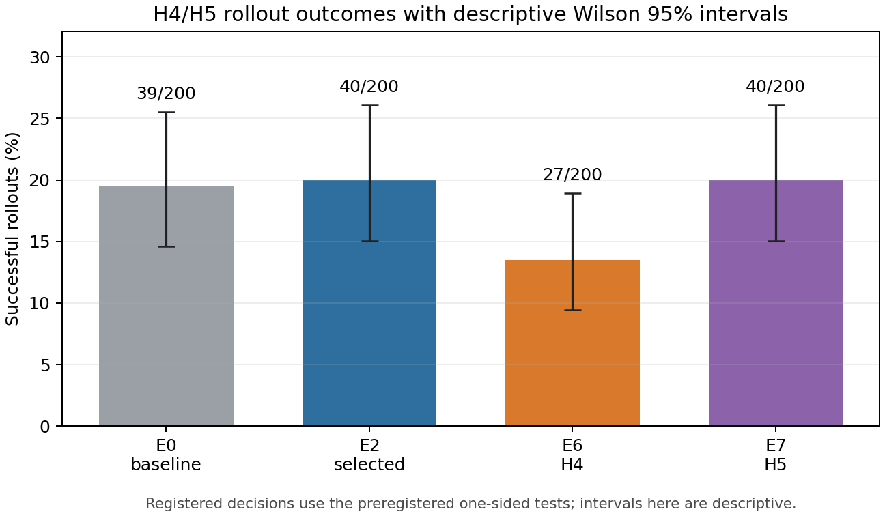
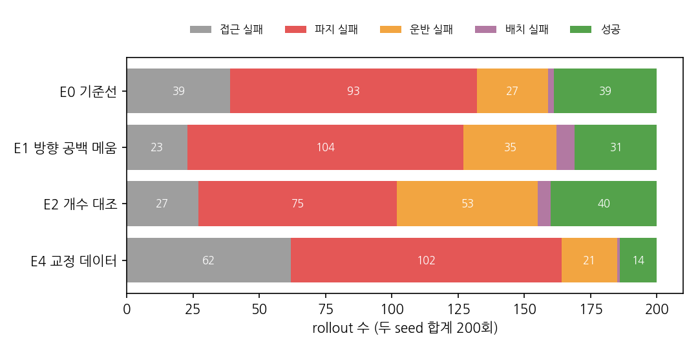
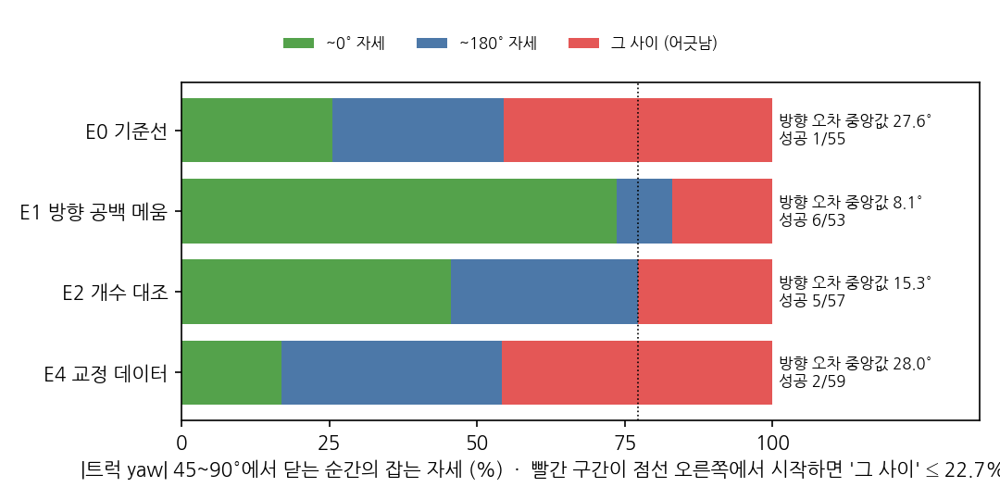
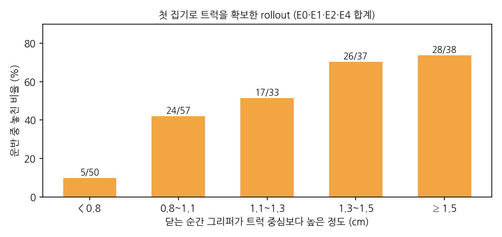
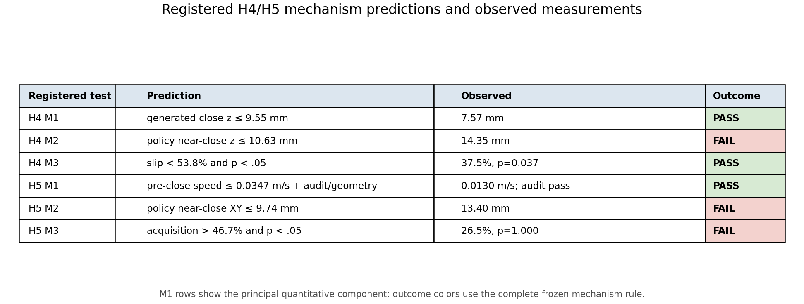
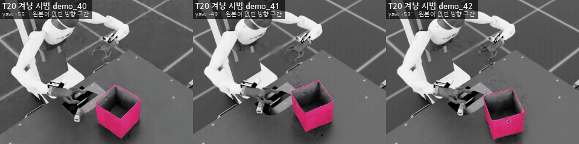
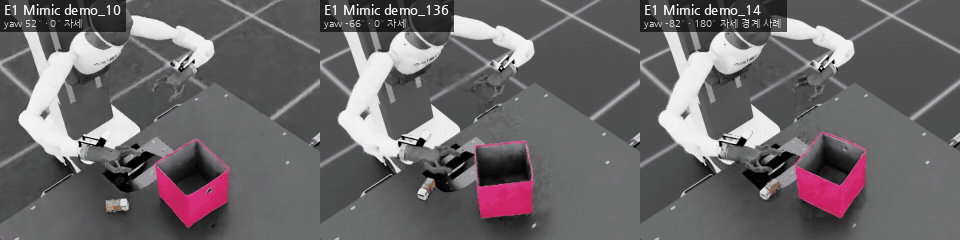
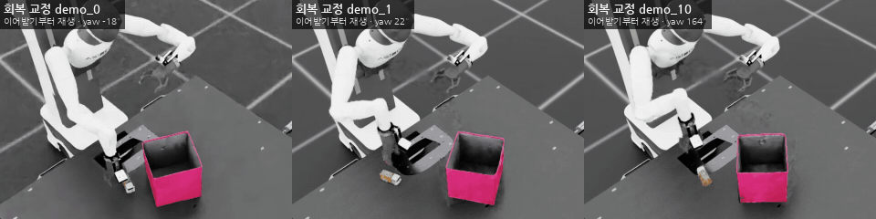
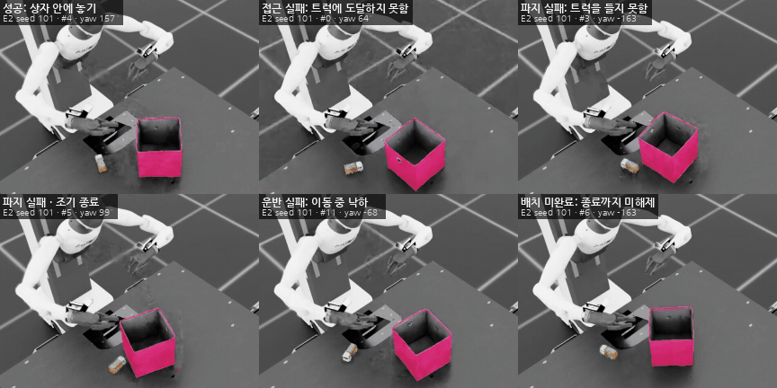

# Toy2Box 모방학습 개선 연구

Agibot 로봇이 장난감 트럭을 집어 상자에 넣는 Toy2Box 작업에서 BC 정책의 실패 원인을 진단하고, 결과 전에 등록한 개입들을 통제 실험으로 검증했습니다.

## 결론부터 보기

| 조건 | 단일 개입 | seed 101 | seed 111 | 합계 | 평균 ± 표본 SD | 합산 Wilson 95% CI |
|---|---|---:|---:|---:|---:|---:|
| E0 | 기준 Mimic 500개 | 19/100 | 20/100 | 39/200 | 19.5% ± 0.71%p | 14.6–25.5% |
| E1 | 방향 공백을 겨냥한 원본 20개 추가 → Mimic 500개 | 21/100 | 10/100 | 31/200 | 15.5% ± 7.78%p | 11.1–21.2% |
| **E2** | 자연 분포 원본 20개 추가 → Mimic 500개 | **18/100** | **22/100** | **40/200** | **20.0% ± 2.83%p** | **15.0–26.1%** |
| E4 | E0 Mimic 500개 + 회복 교정 40개 | 9/100 | 5/100 | 14/200 | 7.0% ± 2.83%p | 4.2–11.4% |
| E6 | E2 생성의 파지 목표를 5 mm 낮춤 | 11/100 | 16/100 | 27/200 | 13.5% ± 3.54%p | 9.4–18.9% |
| E7 | E2 생성의 닫기 직전 접근을 2배 시간 확장 | 15/100 | 25/100 | 40/200 | 20.0% ± 7.07%p | 15.0–26.1% |



- 허용된 후속 개선 실험 두 번까지 모두 수행했지만 **기준선보다 유의한 성공률 개선을 입증하지 못했습니다.** E6는 27/200으로 낮아졌고, E7은 E2와 같은 40/200이었습니다.
- 결과 전에 고정한 규칙에 따라 **E2를 최종 조건으로 유지**했습니다. E2와 E0의 차이는 40/200 대 39/200이며 단측 두 비율 검정에서 유의하지 않습니다(`p = 0.450`). 최종 선택은 개선 입증이 아니라 등록한 선택 규칙의 적용 결과입니다.
- 방향 공백 가설 **H1″은 보류(inconclusive)**입니다. E1은 문제 방향에서 손목 자세 혼동을 줄였지만 두 학습 seed의 전체 성공률이 함께 오르지 않았습니다.
- 회복 데이터 가설 **H3는 기각**했습니다. E4는 성공률과 회복률이 모두 E0보다 낮았습니다.
- 낮은 파지 높이 가설 **H4는 기각**했습니다. 생성 시범의 닫힘 높이는 낮아졌고 정책 rollout의 첫 확보 조건부 미끄러짐 비율은 줄었지만, 정책의 실제 닫힘 높이는 낮아지지 않았고 성공은 27/200으로 줄었습니다.
- 닫기 직전 감속 가설 **H5는 기각**했습니다. 생성 시범의 접근 속도는 낮아졌지만 정책의 실제 수평 정밀도와 확보율은 개선되지 않았습니다. 성공 40/200도 E2와 같았습니다.
- E3(방향 겨냥 데이터 1000개)를 제외했으므로 데이터 양 가설 H2는 검정하지 않았습니다. H1″과 H3가 모두 지지될 때만 실행하기로 한 E5도 실행하지 않았습니다.

세부 판정, 통계, 실패 단계는 [결과 보고서](report/RESULTS.md), 결과 전에 고정한 기준은 [사전 등록 문서](report/PREREGISTRATION.md), 실행 방법은 [재현 문서](report/REPRODUCE.md)에 있습니다.

> **최종 공개 체크포인트 stock 영상 평가 완료**
> 저장소에 공개한 정확한 체크포인트 바이트를 stock `play.py`로 모델당 100회 평가했습니다. seed 101은 18/100, seed 111은 22/100이며 영상도 각각 100개 생성했습니다. 두 길이 100의 Boolean 성공 vector는 관측 평가 결과와 각각 완전히 같아 합계 **200/200** 일치했습니다. [요약 JSON](artifacts/final_eval/summary.json)과 [seed 101 Trial Results](artifacts/final_eval/seed101_stock_trials.txt), [seed 111 Trial Results](artifacts/final_eval/seed111_stock_trials.txt)를 공개합니다.

## 핵심 진단과 판정

### 1. 기준선은 파지에서 가장 많이 실패했다



E0의 200회 평가에서 성공 39회를 제외한 161회 중 파지 실패가 93회였습니다. 원본 시범 40개는 `|yaw| > 90°`에 35개가 몰렸고, `±(45~90)°`에는 하나도 없었습니다. 이 공백에서 E0는 닫는 순간 손목 방향을 한 모드로 정하지 못했습니다.

| `|truck yaw|` 구간 | E0 성공 | 닫힌 trial의 자세 `~0° / ~180° / 그 사이` | 방향 오차 중앙값 |
|---|---:|---:|---:|
| 0~45° | 6/44 | 32 / 1 / 9 | 6.3° |
| **45~90°** | **1/55** | **14 / 16 / 25** | **27.6°** |
| 90~135° | 13/51 | 0 / 49 / 2 | 4.0° |
| 135~180° | 19/50 | 0 / 50 / 0 | 2.6° |

초기 H1은 트럭의 180° 대칭을 이용해 원본을 선택하자는 가설이었습니다. 생성 파일럿에서 파지 자세를 뒤집은 시도의 성공률이 23%에 그쳐, 같은 자세를 유지한 시도의 49%보다 낮았습니다. 트럭과 그리퍼의 실제 접촉은 180° 대칭이 아니었으므로 학습 전에 H1을 기각했습니다.

### 2. 방향을 겨냥한 시범은 자세 혼동을 줄였지만 성공률을 안정적으로 높이지 못했다



E1은 원본 40개에 `|yaw| ≤ 90°` 시범 20개를 구간별로 추가했습니다. 생성 시범의 잡기 규칙 준수율은 전체 **99.0%**였지만 `[−90°,−45°)`는 **87.2%**로 95%에 미치지 못했습니다.

사전 등록한 기제 예측은 성립했습니다.

- `|yaw| = 45~90°`의 닫는 순간 방향 오차 중앙값: **27.6° → 8.1°**
- '그 사이' 자세 비율: **25/55(45.5%) → 9/53(17.0%)**
- 사전 등록 한계: `17.0% ≤ 22.7%`, 방향 오차 `< 10°`

하지만 전체 성공은 seed 101에서 19→21회로 올랐고 seed 111에서는 20→10회로 떨어졌습니다. `|yaw| ≤ 90°` 합계도 7/99→11/96으로 늘었지만 단측 `p = 0.145`였습니다. 따라서 H1″은 지지나 기각이 아니라 **보류**입니다. E1의 21 대 10이라는 큰 seed 편차도 결론의 불확실성을 보여 줍니다.

### 3. DAgger식 회복 교정은 성능을 낮췄다

E4는 E0 Mimic 500개에 정책 실패 상태부터 전문가가 이어서 성공한 교정 40개를 더했습니다. 결과는 14/200으로 E0의 39/200보다 낮았습니다. 첫 근접 닫기 실패 뒤 회복도 2/103으로 E0의 5/102보다 낮았습니다(`p = 0.878`). H3는 사전 등록한 기각 조건을 만족했습니다.

교정 데이터의 원인별 수율은 고르지 않았습니다.

| 감지 종류 | 감지 | 성공 교정 |
|---|---:|---:|
| 파지 실패 | 66 | 32 |
| 접근 정체 | 49 | 5 |
| 운반 중 낙하 | 45 | 3 |

따라서 교정은 전문가가 회복하기 쉬운 상태, 특히 파지 실패 직후에 치우쳤습니다. E4 저하의 단일 원인은 특정하지 못했습니다. 관찰상 근접 닫기 없음은 43→69회, 첫 확보는 55→28회, 회복은 5/102→2/103으로 변했습니다. 교정에는 사전 파지 영역에서 '그리퍼를 연 채 상승'하는 표본 251개가 있었지만, 정책의 같은 행동 비율은 E0 0.2%, E1 1.2%, E2 0.4%, E4 2.3%였습니다. E1 Mimic에는 해당 학습 표본이 4개뿐인데도 정책에서 행동이 나타났으므로 이 관찰만으로 E4 저하의 원인을 단정하지 않습니다.

### 4. 사후 분석에서 운반 중 미끄러짐이 다음 병목으로 나타났다



이 분석은 **결과를 본 뒤 수행했으며 사전 등록 판정에는 사용하지 않았습니다.** 첫 확보 215회 중 100회에서 그리퍼가 열리기 전에 트럭이 빠졌습니다. 닫는 순간 EEF가 트럭 중심보다 높을수록 미끄러짐이 급격히 늘었습니다.

| 닫는 높이 | 미끄러짐 비율 |
|---|---:|
| < 0.8 cm | 10% |
| 0.8~1.1 cm | 42% |
| 1.1~1.3 cm | 52% |
| 1.3~1.5 cm | 70% |
| ≥ 1.5 cm | 74% |

높이 분포 차이의 단측 Mann–Whitney 검정은 `p = 4.5e-10`이었습니다. 들어 올리기 시작 시점의 영향은 높이에 비해 작았습니다. 이는 후속 가설 후보이지 이번 실험으로 확증한 인과 결론이 아닙니다.

### 5. 낮은 생성 목표는 정책의 실제 닫힘 높이로 전이되지 않았다



H4/E6는 E2와 같은 자연 분포 원본 60개만 사용하고, 파지 구간의 목표를 world Z 방향으로 5 mm 낮췄습니다. 생성 시범의 닫힘 높이 중앙값은 **12.547 → 7.565 mm**로 낮아져 M1을 충족했습니다. 정책 rollout에서 첫 확보가 성립한 subset의 미끄러짐 비율도 E2의 42/78에서 E6의 18/48로 줄었고 단측 `p = 0.037`로 M3을 충족했습니다.

그러나 정책의 첫 근접 닫힘 높이는 **13.631 → 14.351 mm**로 오히려 높아져 M2가 실패했습니다. 첫 확보도 78회에서 48회로 줄었고 성공은 27/200이었습니다. 즉 생성 궤적의 낮은 목표와 확보 조건부 미끄러짐 지표가 좋아졌다는 사실만으로 정책의 접촉이나 전체 성공이 개선됐다고 해석할 수 없습니다. 이 실험은 낮은 목표가 미끄러짐 감소를 일으켰다는 인과도 입증하지 않습니다. H4는 등록한 기준에 따라 기각했습니다.

### 6. 생성 시범의 감속도 정책의 수평 정밀도와 확보율로 전이되지 않았다

H5/E7은 같은 원본 60개와 같은 생성 조건에서 닫기 직전 10개 open waypoint 사이에 중간점 9개만 삽입했습니다. 생성 시범의 닫기 직전 속도 중앙값은 **0.0463 → 0.0130 m/s**로 낮아졌고, 생성 XY 오차는 3.705 → 3.672 mm로 유지돼 M1을 충족했습니다.

정책의 첫 근접 닫힘 XY 오차는 **12.739 → 13.399 mm**로 줄지 않았고, 첫 확보/근접 닫힘 비율도 78/167에서 43/162로 낮아져 M2와 M3가 실패했습니다. 확보 뒤 미끄러짐 비율 자체는 42/78에서 17/43으로 낮았지만 확보 수가 크게 줄었고 이는 등록한 H5 기제 성공 기준도 아니므로 인과 개선으로 단정하지 않습니다. seed별 성공은 15/100과 25/100으로 갈렸고 합계는 E2와 같은 40/200이었습니다. 허용된 두 개선 실험을 모두 사용했으므로 기준을 다시 조정하거나 세 번째 개입을 시도하지 않았습니다.

## 영상

그림을 누르면 MP4가 열립니다. 영상 01~07은 원본, 진단, 개입 데이터와 최종 E2 결과를 보여 줍니다.

### 01. 원본 시범

[](artifacts/media/01_source_demos.mp4)

### 02. E0 성공과 단계별 실패

[](artifacts/media/02_baseline_outcomes.mp4)

### 03. 원본 방향 공백의 파지 자세 혼동

[](artifacts/media/03_diagnosis_grasp_mode.mp4)

### 04. T20 문제 방향 시범

[](artifacts/media/04_targeted_demos.mp4)

원본 40개에서 비어 있던 `±(45~90)°` 문제 구간을 겨냥해 추가 수집한 시범입니다.

### 05. E1 Mimic 경계 사례

[](artifacts/media/05_e1_mimic.mp4)

E1 생성 데이터의 양쪽 문제 방향과 0°/180° 파지 경계 사례입니다.

### 06. 회복 교정

[](artifacts/media/06_corrections.mp4)

정책 실패를 감지한 뒤 스크립트 전문가가 이어받아 성공한 교정 구간입니다.

### 07. 최종 E2 성공과 실패

[](artifacts/media/07_final_e2_outcomes.mp4)

최종 조건 E2의 stock 평가에서 고른 성공과 실패 유형입니다.

## 평가 명령

최종 조건 E2의 두 체크포인트는 다음 경로에 있습니다.

```bash
# 학습 seed 101
./isaaclab.sh -p scripts/imitation_learning/robomimic/play.py \
  --task Isaac-Place-Toy2Box-Agibot-Right-Arm-RmpFlow-v0 \
  --checkpoint ./deliverables/toy2box_bc/seed101/model_epoch_2000.pth \
  --num_rollouts 100 --horizon 800 --video --video_length 1000 \
  --video_folder ./videos/eval_seed101 --seed 42 --headless

# 학습 seed 111
./isaaclab.sh -p scripts/imitation_learning/robomimic/play.py \
  --task Isaac-Place-Toy2Box-Agibot-Right-Arm-RmpFlow-v0 \
  --checkpoint ./deliverables/toy2box_bc/seed111/model_epoch_2000.pth \
  --num_rollouts 100 --horizon 800 --video --video_length 1000 \
  --video_folder ./videos/eval_seed111 --seed 42 --headless
```

같은 명령은 [`EVAL_COMMANDS.txt`](EVAL_COMMANDS.txt)에도 있습니다. 평가 환경은 Isaac Sim 5.1.0, Isaac Lab 2.3.0, robomimic 0.4.0입니다.

### 공개 체크포인트의 메타데이터 정리

공개 체크포인트는 학습 원본에서 기계별 절대 경로가 들어 있던 `train.data`와 `train.output_dir` 두 메타데이터만 저장소 상대 경로로 바꾼 파생본입니다. 텐서 저장소 바이트와 그 밖의 decode된 구조는 동일하며, `torch`와 robomimic 로딩을 통과했습니다. 메타데이터가 달라 공개 파일 전체 SHA-256은 원본과 다릅니다. 원본·공개 해시와 변경 필드는 [`metadata_sanitization.json`](deliverables/toy2box_bc/metadata_sanitization.json)에 기록했습니다.

최종 stock 영상 평가는 공개 파생본의 정확한 바이트를 사용했습니다. 평가한 SHA-256은 seed 101 `f0369c5c46f1cb557b564be1bd59c7224c82e467cc3f64607baa3d05771cfe1c`, seed 111 `6103aa6b8b95099078319a40bd3c0254c6c6ec9ce319f162dd0c74aa111eb4eb`입니다. 두 모델 모두 관측 평가의 성공 vector와 일치했지만, 이는 trajectory나 렌더링 pixel의 동일성을 검증한 것이 아닙니다.

## 실험 설계와 공개 범위

- 환경, 성공 판정, 종료 조건, 관측, 행동 공간은 조건 사이에서 바꾸지 않았습니다.
- BC 설정은 학습 seed 101·111을 제외하고 동일합니다. 각 모델은 2000 epoch까지 학습했습니다.
- 각 모델은 평가 seed 42, 100 rollout, horizon 800으로 평가했습니다.
- E6와 E7은 E2와 같은 자연 분포 원본 60개만 사용했습니다. 추가 시범이나 교정을 넣지 않아 원본·교정 합계 100개 상한 안에 있습니다.
- 정책이 달라지면 정책 샘플링과 reset이 같은 난수열을 소비하는 순서도 달라집니다. 따라서 조건별 초기 배치는 완전히 짝지어지지 않았고, 조건 비교에는 비짝지은 두 비율 검정을 사용했습니다.
- 성공한 시범만 남기는 수집 과정에는 생존 편향이 있습니다. 자연 분포 N20 수집에서 `|yaw| > 90°`는 24/51, `|yaw| ≤ 90°`는 4/57이 성공했습니다. T20의 `±(45~90)°` 성공률은 약 4~6%였습니다.
- 재생은 물리 시뮬레이션에서 완전히 결정적이지 않았습니다. E1 `demo_41`, E2 `demo_59`는 원래 성공 기록과 재생 결과가 달랐습니다.
- E2 생성은 E1의 chunk 계획으로 499개를 만든 뒤 seed 12 보충 chunk의 첫 성공 1개를 더해 정확히 500개로 확정했습니다.
- 원본 시범은 사람이 아니라 같은 환경에서 동작하는 스크립트 제어기가 모았습니다.
- 원본 40개, E1/E2 원본 60개, 교정 40개와 최종 가중치는 공개합니다. 큰 Mimic 학습 데이터는 재현 명령과 manifest로 대신합니다.
- 생성 품질 게이트는 episode별 가속도·jerk p95의 코호트 중앙값을 사용했습니다. E6는 0.404 m/s²와 5.876 m/s³, E7은 0.483 m/s²와 6.770 m/s³로 통과했지만, 전체 시계열 최대치는 E6 26.33 m/s²·735.70 m/s³, E7 19.08 m/s²·600.63 m/s³였습니다. 개별 에피소드를 사후 필터링하지 않았으므로 짧은 보간 경계 진동이 남아 있습니다.
- 각 조건은 학습 seed 두 개뿐이며 rollout 배치도 조건 간 완전히 짝지어지지 않았습니다. 따라서 seed 분산과 다른 배치·하드웨어로의 일반화를 충분히 추정하지 못합니다.
- 최종 공개 바이트 검증은 같은 설치 환경에서 수행했습니다. 별도의 clean machine 재현 시험은 아니며, 성공 vector 일치는 trajectory·상태 시계열·영상 pixel 일치를 뜻하지 않습니다.

## 저장소 구조

| 경로 | 내용 |
|---|---|
| [`datasets/`](datasets/) | 원본 40개, E1/E2 원본 60개, 교정 40개 |
| [`deliverables/toy2box_bc/`](deliverables/toy2box_bc/) | 최종 E2 모델 2개 |
| [`scripts/tools/`](scripts/tools/) | 수집, 생성, 교정, 평가 도구와 focused 테스트 |
| [`scripts/tools/toy2box_analysis/`](scripts/tools/toy2box_analysis/) | Sim 없이 실행하는 분석과 사전 등록 판정 코드 |
| [`artifacts/`](artifacts/) | rollout 결과, 통계 원자료, manifest, 그래프, 영상, 체크섬 |
| [`report/`](report/) | [결과](report/RESULTS.md), [사전 등록](report/PREREGISTRATION.md), [재현](report/REPRODUCE.md) |

파일 무결성은 `sha256sum -c artifacts/SHA256SUMS`로 확인할 수 있습니다. 라이선스는 [LICENSE](LICENSE), Mimic 관련 라이선스는 [LICENSE-mimic](LICENSE-mimic), 외부 코드 고지는 [THIRD_PARTY_NOTICES.md](THIRD_PARTY_NOTICES.md)를 확인하세요.

### 추가 재생의 비결정성

영상 05는 저장 당시 성공으로 판정된 E1 Mimic 시범을 다시 실행한 예시입니다. 이번 재생에서 `demo_10`은 상자가 비어 보이고 `demo_136`은 트럭이 상자 밖에 남았습니다. `demo_14`는 상자 안에 놓였습니다. 따라서 세 영상을 모두 성공 재현으로 해석하면 안 됩니다. 수집·학습 통계는 원래 기록을 기준으로 하며, 이 재생 차이를 감추거나 성공 기록을 다시 쓰지 않았습니다.
