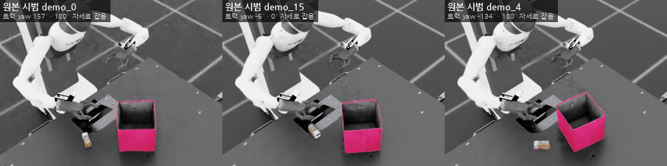
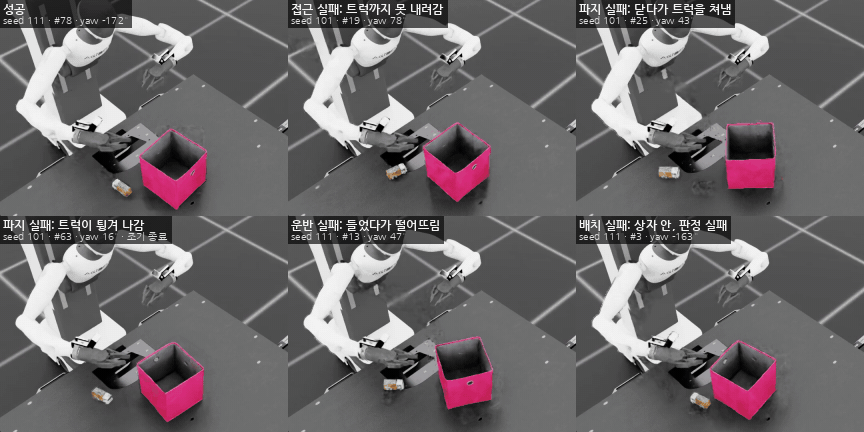
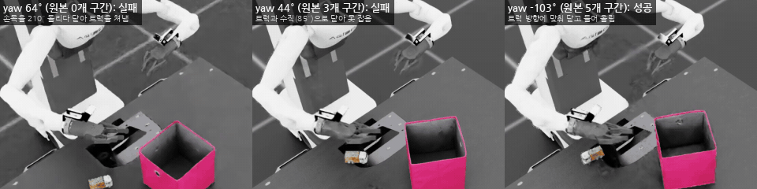
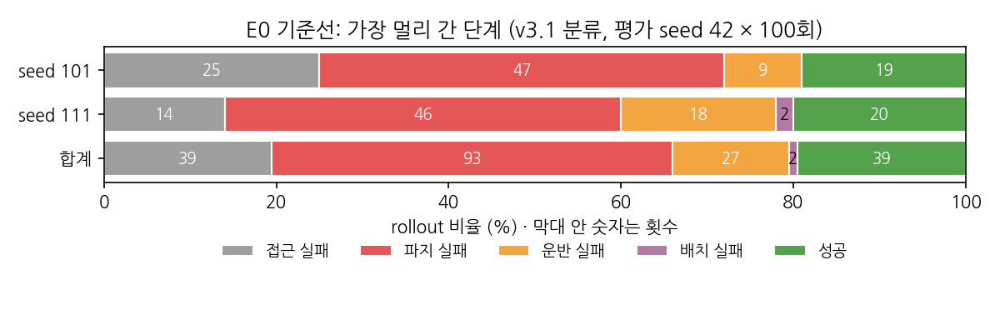
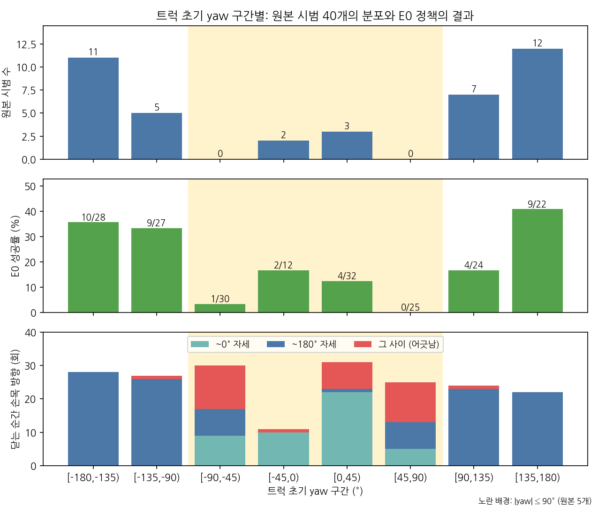

# Toy2Box 모방학습(BC) 성공률 개선 (Robotics Simulation 8주차 과제)

Agibot 로봇이 장난감 트럭을 집어 상자에 넣는 Toy2Box 작업에서, 시범으로 학습한 BC 정책은 다섯 번 중 네 번꼴로 실패합니다.
이 과제의 목표는 실패 원인 하나를 찾고, 그 원인을 겨냥해 성공률을 높이는 것입니다.
기준선을 재현한 뒤 실패를 접근·파지·운반·배치 단계로 나눠 진단했습니다. 가설은 실험 전에 정해 두었고, 한 번에 한 요인만 바꿔 비교했습니다. 기각된 가설도 함께 적었습니다.

> **진행 상태 (2026-10-27)**
> 기준선, 실패 진단, 첫 가설(H1) 판정까지 끝났습니다. 두 번째 가설(H1″) 실험은 진행 중입니다.
> 최종 모델 2개(학습 seed 101·111)와 그 결과는 실험이 끝나는 대로 이 저장소에 추가합니다. [평가 명령](#평가-명령어)의 가중치 경로도 그때 채워집니다.

## 한눈에 보기

| 단계 | 결과 |
|---|---|
| 기준선 (E0) | 성공률 **19.5% ± 0.7%p** (seed 101: 19/100, seed 111: 20/100) |
| 실패 진단 | 실패 161회 중 **파지 실패가 93회(58%)**입니다. 원본 시범이 없는 트럭 방향에서 정책이 잡는 자세(손목 방향)를 정하지 못합니다. |
| 가설 H1: 트럭의 180° 대칭 이용 | **기각.** 이 트럭은 180° 돌려 잡으면 같은 파지가 되지 않습니다(데이터 생성 성공률 23% 대 49%). |
| 가설 H1″: 방향 공백을 시범으로 메움 | 사전 등록 후 실험 중 |

## 과정별 영상

그림을 누르면 MP4가 열립니다. 모든 영상은 시뮬레이션을 편집 없이 잘라 붙인 것이고, 라벨만 덧붙였습니다. 영상의 `#번호`는 평가 rollout 번호입니다.

### 1. 원본 시범 (에이전트 수집 40개)

[](artifacts/media/01_source_demos.mp4)

스크립트 제어기가 모은 원본 시범 중 3개입니다(2배속). 제어기는 트럭 바로 위에서 수직으로 내려와 잡습니다.
손목 방향은 트럭 yaw를 (−90°, 90°]로 접은 값이라, 트럭 방향에 따라 0° 자세나 180° 자세로 잡습니다.

### 2. Mimic 데이터 생성

생성 시범 재생 영상은 실험이 끝난 뒤 추가합니다. 지금은 Isaac Sim이 실험에 쓰이고 있습니다.
생성 방법과 수율은 [재현 문서](report/REPRODUCE.md#2-mimic-데이터-생성)에 있습니다.

### 3. 기준선 BC 정책 (E0): 성공과 단계별 실패

[](artifacts/media/02_baseline_outcomes.mp4)

E0 정책의 평가 rollout 6개입니다(2배속, 40초 → 20초). 단계 라벨은 자동 분류기(v3.1) 값이고, 수동 검증 때도 같은 라벨을 받은 rollout만 골랐습니다.
배치 실패 예시는 트럭이 상자 안에 들어갔지만 환경의 성공 조건을 끝까지 만족하지 못한 경우입니다. 끝난 rollout은 화면을 어둡게 했습니다.

### 4. 진단: 원본이 없는 방향에서 잡는 자세를 정하지 못함

[](artifacts/media/03_diagnosis_grasp_mode.mp4)

같은 seed 101 모델의 rollout 3개입니다(2배속, 0~21초).
- 왼쪽(yaw 64°, 원본 0개): 손목이 1초쯤에 0° 자세로 트럭과 맞았는데도 시계 방향으로 170° 더 돌아 반대 자세로 갑니다(시작부터 210°). 그 뒤 닫다가 트럭을 쳐냅니다.
- 가운데(yaw 44°, 원본 3개): 트럭과 거의 수직(85°)으로 닫아 잡지 못합니다.
- 오른쪽(yaw −103°, 원본 5개): 트럭 방향에 맞춰 닫고 들어 올립니다.

### 5~7. H1″ 시범 수집, 개선 모델 평가, 최종 모델

실험이 끝나면 추가합니다.

## 실패 진단

### 실패는 주로 파지 단계에서 난다



각 rollout을 가장 멀리 간 단계로 분류했습니다. 분류는 트럭 자체의 상태로 판단합니다.

| 단계 | 기준 |
|---|---|
| 배치 실패 | 트럭을 쥔 채 상자 중심 XY 0.12 m 안까지 왔지만 성공 조건을 만족하지 못했다. |
| 운반 실패 | 트럭을 확보했다. 정착 높이보다 3 cm 이상 들린 채, 그리퍼와 6 cm 안으로 40 step(2초) 이상 함께 움직였다. |
| 파지 실패 | 그리퍼가 트럭 6 cm 안에서 닫혔거나 트럭을 건드렸다(XY 1 cm, yaw 5°, 높이 1 cm 이상 변화). 들었다가 2초 안에 놓친 경우도 포함한다. |
| 접근 실패 | 위 어디에도 해당하지 않는다. |

- 처음 만든 분류기(v2)는 실패 영상 20개를 사람이 라벨 없이 판정한 결과와 8/20만 일치해서 버렸습니다.
  트럭 중심 25 mm 안에 와야 접근 성공으로 보는 기준 때문에, 트럭 끝을 잡은 경우가 접근 실패로 분류됐습니다.
- 지금 분류기(v3.1)는 새로 뽑은 실패 영상 20개에서 13개가 정확히 일치했고, 4개는 경계상 양립했습니다(합쳐 85%).
  라벨과 표본은 [`artifacts/e0_baseline/manual_validation/`](artifacts/e0_baseline/manual_validation/)에 있습니다.

### 파지 실패는 원본 시범이 없는 트럭 방향에 몰린다



- 원본 시범 40개 중 35개는 |yaw| > 90°입니다. |yaw| ≤ 90°는 5개뿐이고, ±(45~90)°에는 하나도 없습니다.
- E0 성공은 |yaw| > 90°에서 32/101, |yaw| ≤ 90°에서 7/99입니다. ±(45~90)°에서는 1/55입니다.
- 그리퍼가 트럭에 가장 가까울 때 닫은 순간의 손목 방향 오차(평행 그리퍼라 180° 주기)를 보면 원인이 드러납니다.

| \|트럭 yaw\| | 원본 시범 | 방향 오차 중앙값 | 닫는 순간 자세 ~0° / ~180° / 그 사이 | E0 성공 |
|---|---:|---:|---|---:|
| 0~45° | 5 | 6.3° | 32 / 1 / 9 | 6/44 |
| 45~90° | 0 | **27.6°** | **14 / 16 / 25** | **1/55** |
| 90~135° | 12 | 4.0° | 0 / 49 / 2 | 13/51 |
| 135~180° | 23 | 2.6° | 0 / 50 / 0 | 19/50 |

원본이 많은 방향에서는 정책이 늘 같은 자세(~180°)로 정확히 닫습니다. 원본이 없는 45~90°에서는 0° 자세, 180° 자세, 그 사이로 흩어지고, 거의 다 실패합니다.

### 원인: Mimic은 원본에 없는 방향을 만들어 내지 못한다

Mimic은 새 트럭 배치마다 가장 가까운 원본 시범 3개 중 하나를 골라(위치 차이 + 회전각) 그 궤적을 트럭 자세에 맞게 옮깁니다.
원본이 없는 방향의 목표에는 먼 원본을 크게 돌려 쓰게 됩니다.

- E0 평가 배치 200개로 계산해 보면, 고른 원본과 목표의 yaw 차이 중앙값은 |yaw| 45~90°에서 37.2°입니다. 135~180°에서는 3.3°입니다.
- 그래서 생성 데이터 안에서 이웃한 yaw끼리 잡는 자세가 뒤집힙니다. 생성 시범 500개 중 ±(45~90)° 구간은 0° 자세와 180° 자세가 17:18, 14:27로 섞여 있습니다.
- BC 정책은 섞인 자세를 평균 내듯 배워, 이 구간에서 손목을 크게 돌리다 어긋난 채 닫습니다(위 4번 영상).

분석 스크립트와 원자료는 [`scripts/tools/toy2box_analysis/`](scripts/tools/toy2box_analysis/)와 [`artifacts/e0_baseline/`](artifacts/e0_baseline/)에 있습니다.

## 가설과 실험

가설, 예측, 판정 기준, 최종 모델 고르는 규칙은 결과를 보기 전에 정해 두었습니다. 원문은 [사전 등록 문서](report/PREREGISTRATION.md)에 있습니다.

### H1: 트럭의 180° 대칭을 이용한 원본 선택 (기각)

- **생각:** 평행 그리퍼로 트럭을 잡으면 180° 돌려 잡아도 같을 것이다. 그렇다면 원본과 목표의 트럭 방향을 모두 (−90°, 90°]로 접은 뒤 원본을 고르면, 모든 목표가 가까운 원본에서 생성된다.
  계산으로는 45~90°의 yaw 차이 중앙값이 37.2°에서 5.1°로 줄어들 것으로 예상했습니다.
- **결과:** 본 실험 전 생성 파일럿(같은 chunk seed, 목표 50개)에서 수율이 오르기는커녕 떨어졌습니다.

| 생성 수율 | E0 방식 | 접기 (H1) |
|---|---:|---:|
| 전체 | 51/85 (60%) | 50/140 (36%) |
| [−90°, −45°) | 4/13 | 1/13 |
| [0°, 45°) | 9/18 | 6/30 |
| [45°, 90°) | 4/9 | 0/18 |
| [90°, 135°) | 4/5 | 4/13 |

- **원인 분리:** 원본과 같은 자세로 잡은 시도는 33/67(49%)이 성공했고, 접기 때문에 자세가 바뀐 시도는 17/73(23%)만 성공했습니다.
  특히 180° 자세 원본을 0° 자세 목표에 쓴 경우는 12/67(18%)입니다.
  닫는 순간의 정렬은 실패한 시도도 정확했습니다(방향 2° 이내, 위치 0.5 cm). 차이는 닫는 동안 생겼습니다.
  자세가 바뀐 실패 시도에서는 트럭이 그리퍼 안에서 돌았습니다(닫은 뒤 15 step에 5.5°, 30 step에 8.5°). 같은 자세 시도는 0.3° 이하였습니다.
- **판정:** 이 트럭과 그리퍼의 파지는 180° 대칭이 아닙니다. 예측 1(수율 상승)이 반대로 나와 생성 단계에서 기각하고 학습은 하지 않았습니다.
  자료: [`artifacts/h1_fold_pilot/`](artifacts/h1_fold_pilot/)
- 같은 자세의 원본만 고르는 방법도 계산해 봤습니다. 0° 자세 원본이 5개뿐이라 45~90°의 yaw 차이 중앙값이 60.4°로 더 커져서 버렸습니다.

이 결과는 원본 시범이 한쪽 방향에 몰린 이유도 설명합니다. 수집 제어기는 0° 자세(|yaw| ≤ 90°)에서 자주 실패하므로, 성공한 시범만 남기면 |yaw| > 90°가 많아집니다(생존 편향).

### H1″: 원본 시범의 방향 공백 (진행 중)

- **원인:** 원본 40개가 트럭 방향을 고르게 덮지 않고, Mimic도 대칭도 그 공백을 메우지 못한다.
- **개입 E1:** 같은 수집 제어기로 |yaw| ≤ 90° 배치에서만 시범 20개를 더 모읍니다. 45° 구간 4개에 5개씩입니다(원본 40 + 20 = 60개, 과제 범위 20~100).
  배치는 수집 단계에서 reset을 반복해 고르고, 환경 코드와 배치 분포는 바꾸지 않습니다.
- **대조 E2:** 같은 제어기로 방향을 가리지 않고 20개를 더 모읍니다. 개수는 E1과 같고 방향 범위만 다릅니다.
- **E3:** E1 원본으로 생성 시범 1000개를 씁니다(E1 대비 양만 다름). 최종 후보입니다.

| 조건 | 원본 시범 | 생성 시범 | 비교 대상 |
|---|---|---:|---|
| E0 | 40 | 500 | 기준선 (완료) |
| E1 | 40 + \|yaw\| ≤ 90° 20 | 500 | E0 (H1″ 검정) |
| E2 | 40 + 자연 분포 20 | 500 | E0, E1 (개수 대조) |
| E3 | E1과 같음 | 1000 | E1 (양) |

고정 조건: 생성 설정(E0와 같은 래퍼 설정, 접기 없음), BC 설정 전부, 학습 seed 101·111, 평가 seed 42·100회·horizon 800.

**판정 기준 (사전 등록)**
- 지지: 세 가지를 모두 만족한다.
  1. 두 seed 모두 E0의 같은 seed보다 전체 성공이 높다.
  2. |yaw| ≤ 90° 합산 성공이 E0(7/99)보다 높고, 두 비율 검정에서 단측 p < 0.05다.
  3. ±(45~90)°에서 닫는 순간 '그 사이' 자세가 25/55의 절반 아래로 줄고, |yaw| 45~90°의 방향 오차 중앙값이 10° 아래로 내려간다.
- 기각: |yaw| ≤ 90° 성공이 오르지 않거나 3번이 성립하지 않는다. E2가 E1만큼 오르면 방향이 아니라 개수가 원인으로 보고 기각한다.
- 최종 모델: E1과 E3 중 전체 합산 성공이 높은 쪽, 같으면 E3. E2가 둘 다 넘으면 E2로 하고 그 사실을 적는다.

**지금까지 측정한 것 (E1 수집, 2026-10-27 16:00 기준)**

| 트럭 yaw | 수집 시도 | 제어기 성공 | 성공률 |
|---|---:|---:|---:|
| [−90°, −45°) | 80 | 5 | 6% |
| [−45°, 0°) | 18 | 5 | 28% |
| [0°, 45°) | 16 | 5 | 31% |
| [45°, 90°] | 116 | 5 | 4% |

수집 제어기는 ±(45~90)°에서 거의 성공하지 못합니다. 원본 40개에 이 구간이 없는 이유가 생존 편향이라는 해석과 맞습니다.
성공한 20개 중 원본 40개와 같은 품질·annotation 기준을 통과한 것은 8개라 수집을 더 하고 있습니다.

## 평가 명령어

강의의 play 명령과 같은 형식이고, 저장소 루트에서 실행합니다. Isaac Sim 5.1.0, Isaac Lab 2.3.0, robomimic 0.4.0 환경입니다.

```bash
# 학습 seed 101 모델
./isaaclab.sh -p scripts/imitation_learning/robomimic/play.py \
  --task Isaac-Place-Toy2Box-Agibot-Right-Arm-RmpFlow-v0 \
  --checkpoint ./deliverables/toy2box_bc/seed101/model_epoch_2000.pth \
  --num_rollouts 100 --horizon 800 --video --video_length 1000 \
  --video_folder ./videos/eval_seed101 --seed 42 --headless

# 학습 seed 111 모델
./isaaclab.sh -p scripts/imitation_learning/robomimic/play.py \
  --task Isaac-Place-Toy2Box-Agibot-Right-Arm-RmpFlow-v0 \
  --checkpoint ./deliverables/toy2box_bc/seed111/model_epoch_2000.pth \
  --num_rollouts 100 --horizon 800 --video --video_length 1000 \
  --video_folder ./videos/eval_seed111 --seed 42 --headless
```

- 최종 가중치(`deliverables/toy2box_bc/seed{101,111}/model_epoch_2000.pth`)는 실험이 끝나면 추가합니다. 같은 명령을 [`EVAL_COMMANDS.txt`](EVAL_COMMANDS.txt)에도 적었습니다.
- 결과는 `[INFO] Trial n: True/False` 줄과 마지막 `Trial Results` 목록으로 나옵니다. 성공률은 두 모델의 평균 ± 표준편차(표본 표준편차)로 보고합니다.
- 조교 평가는 공개되지 않은 seed로 하므로 seed 42 값과 다를 수 있습니다.

## 기본 코드에서 바꾼 것

| 항목 | 바꿨나 | 내용 |
|---|---|---|
| 환경, 성공 판정, 종료 조건, 태스크 설정 | 그대로 | 환경 코드는 Isaac Lab v2.3.0 그대로입니다. agibot 태스크에는 강의의 BC 학습 설정 파일과 그 등록 한 줄만 더했습니다. |
| BC 학습 설정 `bc_rnn_low_dim.json` | seed만 | 과제 규칙대로 `"seed"`만 101/111로 바꿔 학습했습니다. 저장소의 파일은 101입니다. |
| 시범 수집 | 추가 | [`record_toy2box_scripted_demos.py`](scripts/tools/record_toy2box_scripted_demos.py): 사람 키보드 시범 대신 쓴 스크립트 수집 제어기. H1″용 yaw 구간 필터 옵션 포함 |
| Mimic 생성 | 래퍼 추가 | [`generate_toy2box_settled.py`](scripts/tools/generate_toy2box_settled.py): 강의의 `generate_dataset.py`는 이 시범에서 성공 0개였습니다. 런타임 보정만 더했습니다(아래). |
| 평가 | 옵션 추가 | `play.py`에 `--video`, `--video_length`, `--video_folder`만 더했습니다. 평가 로직은 그대로입니다. |
| 진단 | 도구 추가 | [`evaluate_toy2box_bc.py`](scripts/tools/evaluate_toy2box_bc.py): stock `play.py`를 그대로 실행하며 매 step 상태를 기록합니다. 성공 vector가 stock 실행과 200/200 같았습니다. |

Mimic 생성 래퍼의 보정은 6가지입니다. 시작 때 물체가 멈출 때까지 기다리기, env마다 RMPflow 초기화, 행동 noise 0, 두 번째 subtask(상자)의 원본을 로봇 거리로 다시 고르기, 들어 올림 offset 50~60 step, 상자 구간 보간 30 step입니다.
환경, 성공 판정, 종료 조건, 관측과 행동은 바꾸지 않습니다. 자세한 내용은 [재현 문서](report/REPRODUCE.md)에 있습니다.

## 알려 둘 것

- **시범:** 과제는 사람 시범 20~100개를 쓰라고 합니다. 이 저장소의 원본 시범 40개는 사람이 아니라 스크립트 제어기(에이전트)가 수집한 것이고, 그렇게 대신하기로 정했습니다.
- **기준 코드:** 수업 저장소가 아니라 upstream Isaac Lab v2.3.0에 강의 PDF 내용을 다시 구성한 코드입니다. Isaac Lab 원래 README는 [`README_ISAACLAB.md`](README_ISAACLAB.md)로 옮겼습니다.
- **학습 seed:** 과제 규칙 본문의 101·111을 썼습니다. 업로드 안내에는 "101 + 102"로 적혀 있어 서로 다릅니다.
- **비교 방식:** 정책이 다르면 같은 평가 seed라도 rollout별 배치가 달라질 수 있습니다(GMM 샘플링과 reset이 같은 난수열을 씁니다). 그래서 조건 간 비교는 짝을 짓지 않습니다.
- 모든 결과는 시뮬레이션 결과입니다. 생성 데이터(245 MB 이상)는 올리지 않고 재생성 명령만 적었습니다.

## 파일 구성

| 경로 | 내용 |
|---|---|
| [`datasets/`](datasets/) | 원본 시범 40개 (raw, Mimic annotation 포함) |
| [`deliverables/toy2box_bc/`](deliverables/toy2box_bc/) | 최종 모델 2개 (실험 종료 후 추가) |
| [`scripts/tools/`](scripts/tools/) | 수집기, 생성 래퍼, 관측 평가기, 단계 분류기와 테스트 |
| [`scripts/tools/toy2box_analysis/`](scripts/tools/toy2box_analysis/) | 진단 분석 스크립트 (시뮬레이터 없이 실행) |
| [`artifacts/`](artifacts/) | 결과 원자료, 그래프, 영상, `SHA256SUMS` |
| [`report/`](report/) | [사전 등록](report/PREREGISTRATION.md), [재현 방법](report/REPRODUCE.md) |
| 그 밖 | Isaac Lab v2.3.0 프로젝트 폴더 |

파일 무결성은 `sha256sum -c artifacts/SHA256SUMS`로 확인할 수 있습니다.
라이선스는 Isaac Lab과 같습니다([LICENSE](LICENSE), [LICENSE-mimic](LICENSE-mimic)). 외부 코드는 [THIRD_PARTY_NOTICES.md](THIRD_PARTY_NOTICES.md)를 보세요.
